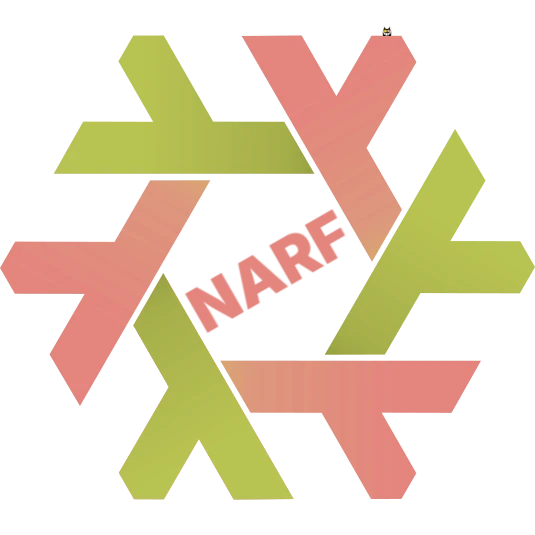

<div align="center">



# NARF

_NixOS Advanced Rebuild Flake_

[](CHANGELOG.md)
[](https://github.com/farbzen/narf/actions/workflows/rust.yml?query=branch%3Amain+event%3Apush)
[](flake.nix)
[](Cargo.toml)
[](https://narf.farbzen.de/)
[](LICENSE)
[](https://ko-fi.com/farbzen)

[Overview](#overview) • [Features](#features) •
[Getting Started](#getting-started) • [Documentation](#documentation)

</div>

NARF rebuilds a NixOS configuration flake and records every rebuild as a git
commit; it is meant for NixOS users who manage their systems with a flake in a
git repository.

## Overview

A plain `nixos-rebuild` leaves no trace in the configuration repository. NARF
wraps update, rebuild and commit into one step, so the git history of the flake
doubles as a log of every generation built on each host.

The repository consists of the following applications:

- **narf** – command-line tool that updates, rebuilds and commits a NixOS
  flake, built with [clap](https://docs.rs/clap) and
  [cliclack](https://docs.rs/cliclack). The code lives in `narf/`.
- **narf-tui** – terminal UI frontend for NARF, built with
  [ratatui](https://ratatui.rs) and [tui-term](https://docs.rs/tui-term). The
  code lives in `narf-tui/`.

## Features

- **Rebuild as commit**: every new generation is committed with host,
  generation number, NixOS and kernel version in the message, optionally with
  a comment (`-c`).
- **Input updates**: update all flake inputs (`-u`) or selected ones (`-U`)
  before rebuilding.
- **Git sync**: pull before (`-p`) and push after (`-P`) the rebuild, with
  unpushed rebuild commits squashed into one unless `-S` is given.
- **Safe modes**: dry run (`-d`), build without switching (`-b`) and pushing
  existing commits without rebuilding (`-n`).
- **Scriptable**: answer all prompts with yes (`-y`) and show a trace of
  failing rebuilds (`-t`).
- **Remembered flake**: the flake path is saved in `~/.config/narf/flake`, the
  host defaults to the current hostname.
- **TUI**: pick options in a form or by their flag letter, see the repository
  state (upstream, unpushed commits, changes, inputs) and run NARF in an
  embedded terminal.

## Getting Started

### Prerequisites

- [Nix](https://nixos.org); the flake outputs need the `nix-command` and
  `flakes` features
- a NixOS configuration flake in a git repository, which NARF rebuilds

### Installation

Try both applications without installing:

```sh
nix run github:farbzen/narf -- --help
nix run github:farbzen/narf#narf-tui
```

To install them on NixOS, add the flake as an input and its overlay to the
configuration:

```nix
inputs.narf.url = "github:farbzen/narf";
# in a NixOS module:
nixpkgs.overlays = [narf.overlays.default];
environment.systemPackages = [pkgs.narf];
```

> [!NOTE]
> `narf` and `narf-tui` are the same derivation; installing one of them puts
> both binaries on the `PATH`.

Without the flake, copy [`package.nix`](package.nix) into the configuration
and add `(pkgs.callPackage ./narf.nix {})` to `environment.systemPackages`.

The full examples are in [docs/installation.md](docs/installation.md).

### Usage

```sh
narf --update --push      # update inputs, rebuild, commit and push
narf --dry                # only show what would be done
narf -U nixpkgs -b        # update only nixpkgs, build without switching
narf-tui                  # interactive frontend
```

Without `--flake`, NARF reads the flake path from `~/.config/narf/flake` and
offers to save a new `--flake` value there. All options: `narf --help` and
[docs/usage.md](docs/usage.md).

## Documentation

The documentation is published at <https://narf.farbzen.de/>; its
source lives in `docs/`:

- [Installation and flake outputs](docs/installation.md)
- [Usage: options, steps of a run, commit message](docs/usage.md)
- [TUI: layout and keys](docs/tui.md)
- [Development environment, tests, build, documentation and release](docs/development.md)
- [Changelog](CHANGELOG.md)
- [Legal Notice](docs/legal.md)

## License

See [LICENSE](LICENSE).
